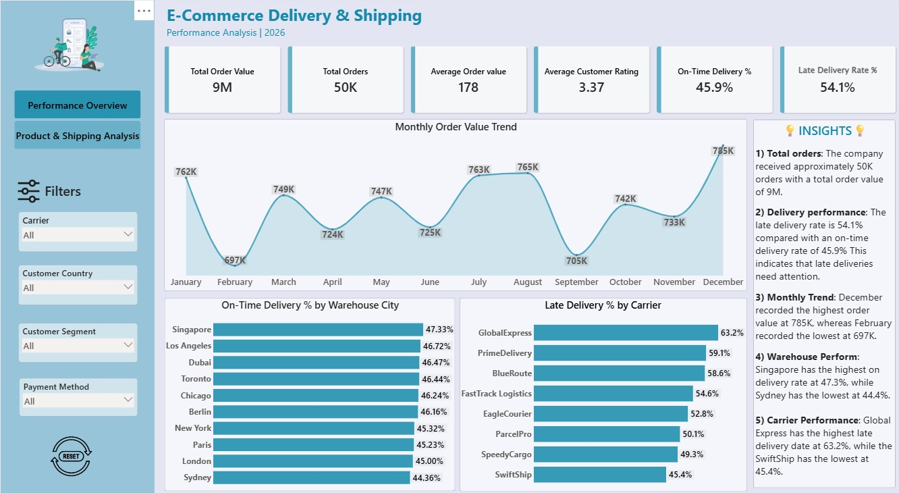
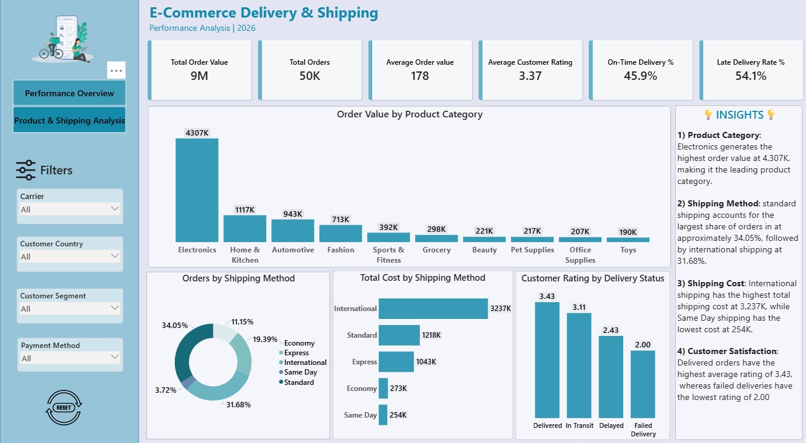

# E-Commerce Analytics Dashboard | Power BI

  <strong>An interactive Power BI project exploring e-commerce performance, products, and delivery operations.</strong>

  
  
  

## Project Overview

This project uses e-commerce delivery and shipping data to explore business performance, order trends, product categories, shipping costs, and delivery outcomes. The report presents key metrics and visual analysis across two dashboard pages.

## Dashboard Preview

### 1. Performance Overview

This page provides a high-level view of order and delivery performance, including total order value, total orders, average order value, on-time delivery, late delivery, and monthly trends.

  

  
<strong>View Performance Overview image</strong>

  

    
  

### 2. Product and Shipping Analysis

This page explores product category performance, shipping methods and costs, customer ratings, and delivery status.

  

  
<strong>View Product and Shipping Analysis image</strong>

  

    
  

## Key Areas of Analysis

| Area | What it helps examine |
|---|---|
| Order performance | Order volume and order value |
| Monthly trends | Changes in order value over time |
| Delivery performance | On-time and late delivery rates |
| Product categories | Differences across product categories |
| Shipping methods | Order distribution by shipping method |
| Shipping costs | Shipping expense patterns |
| Customer ratings | Ratings across delivery outcomes |
| Delivery status | Delivered, delayed, failed, and in-transit orders |

## Tools and Skills

- **Microsoft Power BI** — dashboard development and data visualization
- **Power Query** — data cleaning and transformation
- **DAX** — calculated measures and KPI calculations
- **Data analysis** — exploring business and operational performance

## Repository Contents

| File | Description |
|---|---|
| `E-Commerce analytics.pbix` | Power BI report |
| `E-commerce_Delivery_Shipping_Data_2026.csv` | Source dataset |
| `Performance_Overview.jpg` | First dashboard page |
| `Product_and_Shipping_Analysis.jpg` | Second dashboard page |

## How to Explore the Project

1. Open the `.pbix` file in Microsoft Power BI Desktop.
2. If prompted, update the CSV source path to the location where you saved the dataset.
3. Refresh the data if required.
4. Explore both report pages and interact with the available slicers and visuals.

## Project Learning

Working on this project helped me practice preparing data, creating DAX measures, selecting visualizations, and presenting business information through an interactive report.

## Feedback

I welcome suggestions and feedback that can help me improve my data analysis and Power BI skills.

---

**Created by Rehan Ansari**  
Aspiring Data Analyst

[GitHub Profile](https://github.com/rehanansari2517-qua) · [LinkedIn Profile](https://www.linkedin.com/in/rehan-ansari-0005753b0/)
